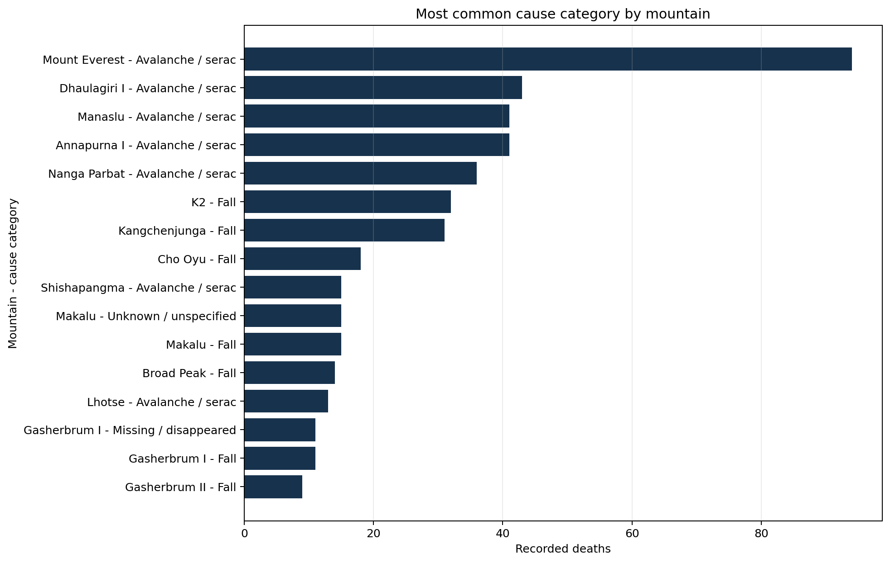
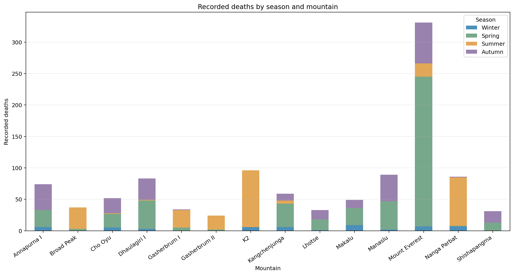
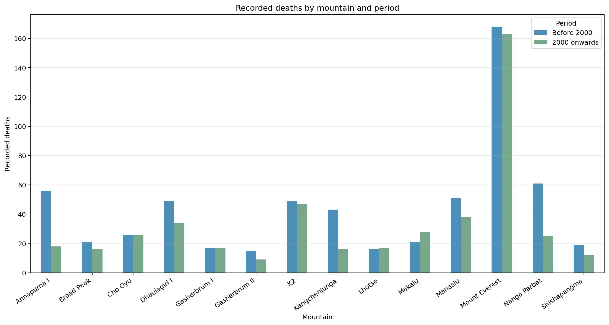

# Deaths on the World's Eight-Thousanders

This project analyzes the records in `deaths_on_eight-thousanders.csv`. The notebook explains the analysis and creates summary tables and charts.

## Run the analysis

Python 3.10 or later is required. Install the dependencies:

```powershell
python -m pip install -r requirements.txt
```

Open the notebook in JupyterLab or Visual Studio Code:

```powershell
jupyter lab notebooks/deaths_analysis.ipynb
```

Run all cells from top to bottom. The notebook reads the source CSV and recreates the files in `outputs/`.

## Summary tables

- `outputs/deaths_by_cause_and_mountain.csv` — recorded deaths grouped into consistent cause categories for each mountain. `is_most_common` marks the most frequent category, including ties.
- `outputs/deaths_by_season_and_mountain.csv` — records grouped by season and mountain.
- `outputs/deaths_by_period_and_mountain.csv` — comparison of years before 2000 with 2000 and later.

## Charts

The notebook saves these visualizations as PNG files in `outputs/figures/`.

### Most common cause category by mountain

Each mountain is paired with its most frequent cause category; ties are included. Cause categories group different source descriptions, so the chart is a simplified summary rather than a literal breakdown of the original descriptions.



### Season

The chart compares record counts for winter, spring, summer, and autumn, using Northern Hemisphere seasons. The counts show the records in the source and are not adjusted for the number of expeditions in each season.



### Period relative to 2000

The chart compares records from before 2000 with 2000 and later. These counts alone do not establish a change in risk because they do not account for the number of climbers or data completeness across periods.



## Method and limitations

Dates are parsed in ISO format (`YYYY-MM-DD`). Cause categories are assigned using explicit keyword rules. Empty or explicitly unknown causes are labeled `Unknown / unspecified`; descriptions that do not match a rule are labeled `Other / unclear`. The source CSV is not modified.

Records with missing or invalid dates remain included in cause summaries but are not assigned to a season or period. The counts represent records in the supplied file and may not be a complete historical account of accidents. Differences between mountains or seasons may reflect the number of expeditions, the time span covered by the source, or its completeness, as well as differences in risk.
